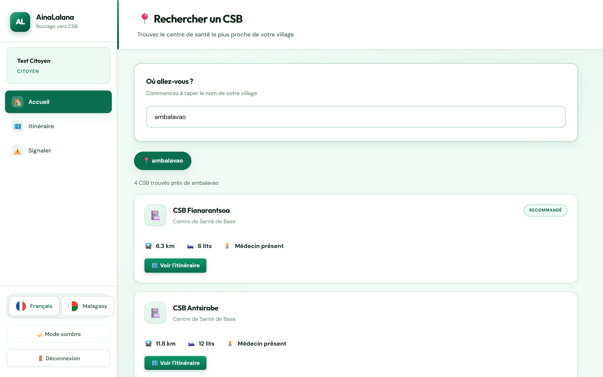
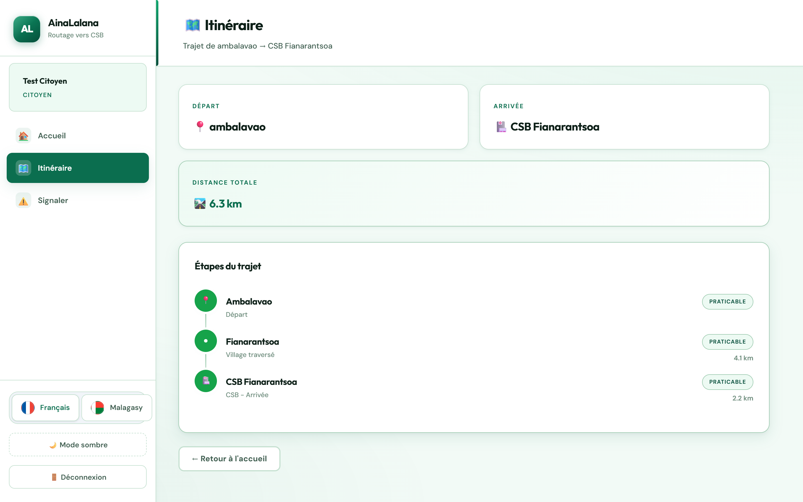
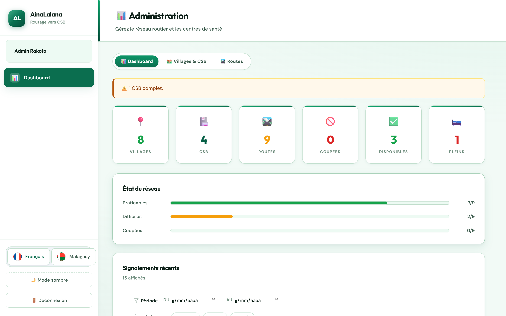
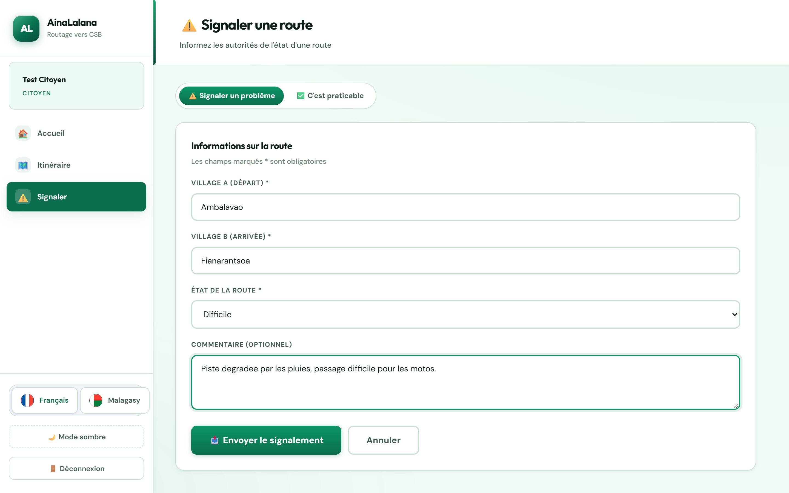

# AinaLalana — Routage médical rural

> Plateforme de mise en relation entre villages isolés et centres de santé de base (CSB),
> avec calcul d'itinéraire sur un réseau routier dont l'état est signalé en temps réel.

**React 18 · Vite · Flask · MySQL · i18n français / malagasy**


---

## Le problème

À Madagascar, dans les zones rurales, rejoindre un centre de santé suppose de choisir
la bonne route — et une route peut être coupée, inondée ou dégradée sans que personne
ne le sache avant d'être sur place. Ce projet répond à trois besoins :

- **le citoyen** trouve le CSB le plus proche et praticable depuis son village ;
- **le gestionnaire de CSB** tient à jour ses lits disponibles et la présence d'un médecin ;
- **le chef de district** suit l'état du réseau routier et les signalements.

## Fonctionnalités

| Rôle | Fonctionnalités |
|---|---|
| Citoyen | recherche de village avec autocomplétion, CSB classés par distance et accessibilité, itinéraire détaillé étape par étape, signalement de l'état d'une route |
| Gestionnaire CSB | consultation de son CSB, mise à jour des lits disponibles et de la présence d'un médecin |
| Chef de district | tableau de bord (villages, CSB, routes, routes coupées), état du réseau, CRUD des lieux et des routes, historique des signalements filtrable par période |

Interface bilingue **français / malagasy**, thème clair et sombre, responsive (mobile inclus).

## Architecture

```
frontend-react/            React 18 + Vite (SPA)
        │  build → dist/
        ▼
backend_api.py             Flask : sert dist/ ET l'API REST /api/*
        │
        ▼
database/DAO/              DAO MySQL (connexion robuste + reconnexion)
        │
        ▼
MySQL — base `ainalalana`
```

Un seul processus sert le frontend et l'API : le déploiement ne demande qu'un service.

```
backend/
  controllers/   points d'entrée (auth, citoyen, gestionnaire, admin)
  services/      logique métier (CSB, routage, signalement, recherche)
  models/        Lieu, Route, Utilisateur, Itineraire, EtapeItineraire
  utils/         dijkstra, tas binaire, graphe, KMP, Trie
database/
  DAO/           accès MySQL
  schema.sql     schéma + données de démonstration
frontend-react/
  src/pages/     Login, Citoyen, Itineraire, Signalement, Gestionnaire, Admin
  src/locales/   fr.json, mg.json
docs/screenshots/  captures utilisées par ce README
```

## Algorithmes

Les structures sont implémentées à la main (pas de bibliothèque) et comparées à une
version naïve ; mesures détaillées dans [WORLD.md](WORLD.md).

| Algorithme | Version naïve | Version optimisée | Gain |
|---|---|---|---|
| Tas binaire (1 000 opérations) | 0,0769 s | 0,0294 s | **×2,61** |
| Dijkstra (100 nœuds) | 0,0159 s | 0,0027 s | **×5,91** |
| Trie (autocomplétion) | 0,0101 s | 0,2222 s | plus lent sur petits volumes |
| KMP (recherche de motif) | 0,0000 s | 0,0028 s | plus lent sur petits volumes |

Le Trie et KMP sont volontairement conservés : leur intérêt apparaît quand le volume de
données dépasse la mémoire cache, ce que le rapport documente honnêtement.

## Démarrage rapide

### Prérequis

- Python 3.10+
- Node.js 18+
- MySQL 5.6+ (WAMP, XAMPP, MySQL Server…)

### 1. Base de données

```bash
mysql -u root -p < database/schema.sql
# données historiques de signalements (optionnel)
mysql -u root -p ainalalana < seed_signalements_anciens.sql
```

`schema.sql` crée la base `ainalalana`, les 6 tables et un jeu de démonstration
(8 villages, 4 CSB, 9 routes, 3 utilisateurs).

### 2. Backend

```bash
python -m pip install -r requirements.txt
python backend_api.py
```

Le serveur écoute sur <http://localhost:5000>. Il lit la configuration dans
l'environnement (voir `.env.example`) ; les valeurs par défaut correspondent à un
MySQL local `root` sans mot de passe.

### 3. Frontend

```bash
cd frontend-react
npm install
npm run build      # génère dist/, servi directement par Flask
```

**Raccourci Windows** : `run.bat` installe les dépendances si besoin, construit le
frontend s'il est absent, puis lance le serveur.

```powershell
.\run.bat
```

### Développement du frontend

```bash
cd frontend-react
npm run dev        # Vite sur http://localhost:5173 (hot reload)
```

## Comptes de démonstration

| Rôle | Email | Mot de passe |
|---|---|---|
| Chef de district | `admin@test.com` | `admin123` |
| Gestionnaire CSB | `gest@test.com` | `gest123` |
| Citoyen | `citoyen@test.com` | `citoyen123` |

Ces comptes sont créés par `database/schema.sql` et affichés sur la page de connexion
(bloc « Comptes de démonstration », cliquable pour pré-remplir le formulaire).

## Configuration

Toutes les variables sont optionnelles en local.

| Variable | Défaut | Rôle |
|---|---|---|
| `DB_HOST` | `localhost` | hôte MySQL |
| `DB_PORT` | `3306` | port MySQL |
| `DB_NAME` | `ainalalana` | nom de la base |
| `DB_USER` | `root` | utilisateur |
| `DB_PASSWORD` | *(vide)* | mot de passe |
| `DB_SSL` | — | `true` pour activer TLS (bases managées) |
| `DB_SSL_CA` | — | chemin du certificat CA |
| `PORT` | `5000` | port d'écoute |
| `DEBUG_ERREURS` | `1` | `0` = messages d'erreur génériques (production) |
| `FLASK_DEBUG` | `0` | `1` = rechargement automatique |
| `ENABLE_DEBUG_API` | `0` | `1` = active `/api/admin/debug/etat` |

Copier `.env.example` en `.env` pour les définir localement (le fichier `.env` est
ignoré par Git).

## Déploiement

Le backend servant le build React, **un seul service web suffit**.

```bash
pip install -r requirements.txt
cd frontend-react && npm ci && npm run build && cd ..
gunicorn backend_api:app --bind 0.0.0.0:$PORT --workers 2 --timeout 120
```

Le `Procfile` fourni contient déjà cette commande.

**Variables à définir sur l'hébergeur** (obligatoire) :

```
DB_HOST, DB_PORT, DB_NAME, DB_USER, DB_PASSWORD, DB_SSL=true
DEBUG_ERREURS=0
```

Penser à importer `database/schema.sql` sur la base distante avant le premier démarrage.

> Hébergement gratuit : le service s'endort après quelques minutes d'inactivité et met
> 30 à 60 s à se réveiller. Prévoir un ping périodique ou une vidéo de secours sur le
> portfolio.

## Captures

| | |
|---|---|
|  |  |
|  |  |

## Limites connues

- Les mots de passe sont stockés **en clair** : acceptable pour une démonstration,
  à remplacer par un hachage (`werkzeug.security`) avant tout usage réel.
- Les sessions sont conservées côté serveur en mémoire : un redémarrage déconnecte
  les utilisateurs.
- `seed_signalements_anciens.sql` contient un bloc commenté qui référence des lieux
  (`village-009`, `csb-005`) absents de `schema.sql`.
